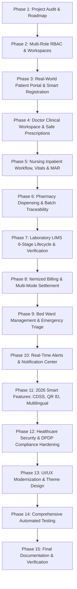

# PROJECT AUDIT REPORT & MODERNIZATION ROADMAP
## City General Hospital — Smart Healthcare Management Platform (2026–2030)

**Document Version:** 1.0.0  
**Audit Date:** November 14, 2026  
**Auditor Roles:** Senior Healthcare Software Architect, Lead Security Engineer, Clinical Informatics Specialist, Database Architect  
**Project Workspace:** `HospitalManagementSystem` (`.NET 10.0`, C#, EF Core, ASP.NET Core Identity)  

---

## 1. EXECUTIVE SUMMARY

An exhaustive technical, architectural, clinical workflow, and cybersecurity audit was conducted on the existing **City General Hospital Management System** codebase. 

The application is built on **ASP.NET Core 10.0 MVC** utilizing **Entity Framework Core 10.0** with dual database support (SQLite local file database `HospitalManagement.db` and Microsoft SQL Server LocalDB), **ASP.NET Core Identity**, and a Bootstrap 5 / FontAwesome frontend.

### Primary Audit Findings:
1. **Solid Foundation:** The existing system contains 20 MVC controllers, 22 domain entities, and baseline modules covering OPD, IPD, Appointments, Billing, Blood Bank, Emergency, Pharmacy, Laboratory, and Prescriptions.
2. **Critical Security Vulnerabilities:**
   - **Public Anonymous Access to Patient Prescriptions (ASP0026):** `PrescriptionsController.Details` contains an `[AllowAnonymous]` attribute that overrides `[Authorize]`, exposing private clinical records to the unauthenticated public internet.
   - **Horizontal Privilege Escalation (IDOR):** Lack of resource-level ownership validation allows any authenticated patient or user to view other patients' prescriptions, lab results, and billing invoices simply by enumerating sequential integer IDs (`/Prescriptions/Print/2`, `/Billing/Invoice/3`).
   - **Self-Service Role Escalation:** `AccountController.Register` accepts arbitrary role selections (`Doctor`, `Nurse`, `Receptionist`, and potentially `Admin`) directly from unauthenticated public POST requests without administrative verification.
3. **Clinical & Operational Deficiencies:**
   - **One-Size-Fits-All Interface:** All users are redirected to a single administrative hospital KPI dashboard. Doctors, nurses, patients, pharmacists, and lab technicians lack tailored clinical workspaces.
   - **Missing Nursing Inpatient Workflow:** Absence of vital signs charting, Medication Administration Records (MAR), and nurse shift handovers.
   - **Broken Clinical Linkages:** Pharmacy dispensing is disconnected from doctor prescriptions; laboratory results bypass clinical verification; emergency bed assignments fail to synchronize bed occupancy.
   - **Data Race Conditions:** Sequential code generation (`PAT-001`, `APT-0001`, `RX-0001`, `BILL-0001`) relies on `CountAsync() + 1`, causing primary key collision crashes during concurrent operations.
4. **Preservation Commitment:** All working functionality, database seeds, and existing business models will be strictly preserved, hardened, and augmented.

---

## 2. EXISTING ARCHITECTURE & TECHNOLOGY STACK

```
┌────────────────────────────────────────────────────────────────────────┐
│                        PRESENTATION LAYER                              │
│   ASP.NET Core 10 MVC Razor Views, Bootstrap 5.3, FontAwesome 6.5,     │
│   Chart.js 4.x (Client-side charts), wwwroot/css/site.css (Custom CSS) │
└────────────────────────────────────┬───────────────────────────────────┘
                                     │ HTTP / HTTPS
┌────────────────────────────────────▼───────────────────────────────────┐
│                        APPLICATION CONTROLLERS                         │
│   20 MVC Controllers: Account, Admissions, Appointments, Beds,         │
│   Billing, BloodBank, Dashboard, Departments, Doctors, Emergency,      │
│   Expenses, Home, Inventory, Laboratory, Notifications, OPD,           │
│   Patients, Pharmacy, Prescriptions, Reports, Staff                    │
└────────────────────────────────────┬───────────────────────────────────┘
                                     │ Dependency Injection
┌────────────────────────────────────▼───────────────────────────────────┐
│                        SERVICE & LOGIC LAYER                           │
│   Services/AppServices.cs:                                             │
│   ├── IAuditService / AuditService                                     │
│   ├── INotificationService / NotificationService                       │
│   └── IDashboardService / DashboardService                             │
└────────────────────────────────────┬───────────────────────────────────┘
                                     │ Entity Framework Core 10.0
┌────────────────────────────────────▼───────────────────────────────────┐
│                        DATA ACCESS LAYER                               │
│   Data/ApplicationDbContext.cs (IdentityDbContext<ApplicationUser>)   │
│   Data/DatabaseSeeder.cs (Auto-seeding Roles, Users, Departments, etc.)│
│   Configurable Database Provider: SQLite or SQL Server                 │
└────────────────────────────────────┬───────────────────────────────────┘
                                     │
┌────────────────────────────────────▼───────────────────────────────────┐
│                        PHYSICAL PERSISTENCE                            │
│   Default: HospitalManagement.db (SQLite 3.x, zero-config local engine)│
│   Optional: Microsoft SQL Server LocalDB                               │
└────────────────────────────────────────────────────────────────────────┘
```

### Components Inventory:
- **Runtime:** .NET 10.0 (`net10.0`), Nullable reference types enabled, Implicit Usings enabled.
- **Identity:** `Microsoft.AspNetCore.Identity.EntityFrameworkCore 10.0.0` with cookie authentication (`8-hour` sliding expiration).
- **ORM:** `Microsoft.EntityFrameworkCore.Sqlite 10.0.0` and `Microsoft.EntityFrameworkCore.SqlServer 10.0.0`.
- **Database Architecture:** `ApplicationDbContext` with explicit `DeleteBehavior.Restrict` on foreign keys to prevent cyclic cascade path failures. Composite unique index `UQ_Appointment_Doctor_DateTime` preventing doctor double-booking. Unique index `UQ_Patient_Code` on patient codes.

---

## 3. AUDIT OF EXISTING FEATURES

| Module | Existing Features | Status | Deficiencies Identified |
| :--- | :--- | :--- | :--- |
| **Authentication & Identity** | Email/password login, account lockout (5 attempts / 5 mins), self-registration, password change | ⚠️ Vulnerable | Role escalation bug in `Register`, missing multi-factor/session guards, no automatic linking of `Doctor`/`Patient` to `ApplicationUser`. |
| **Dashboard** | 8 KPI statistics, Chart.js revenue trend, department distribution, today's appointments table | ⚠️ Partial | Generic administrator view shown to all roles. Doctors, nurses, pharmacists, and patients cannot see role-specific priorities. |
| **Patient Management** | Unique code (`PAT-xxx`), demographics, emergency contact, timeline view of visits/prescriptions/bills | ⚠️ Partial | Missing duplicate patient detection (phone/email/DOB matching). Patients cannot view or manage their own profiles. |
| **Appointments** | Cascading department-doctor selection, duplicate booking DB constraint, status tracking | ⚠️ Partial | `AppointmentsController` restricts access to `Admin,Doctor,Receptionist`. Patients cannot book online. Unhandled `TimeSpan.Parse` exception risk. |
| **OPD Queue** | Daily token generation, waiting/in-consultation/completed status flow, vital signs capture | ⚠️ Partial | No live queue board for waiting area. Estimated wait times are not computed. Doctors lack streamlined consultation call system. |
| **Emergency & Trauma** | 3-tier triage (Critical/Serious/Stable), walk-in support, treatment tracking | ⚠️ Partial | Bed status is not synchronized to `Occupied` upon emergency admission. Emergency triage lacks clinical audit trail. |
| **Inpatient (IPD) & Beds** | Bed grid with 4 categories (General, ICU, Private, Emergency), admission creation, discharge summary | ⚠️ Partial | Discharged beds immediately flip to `Available` instead of entering `Cleaning/Maintenance`. No nursing vitals charts or MAR. |
| **Prescriptions** | Multi-medicine line items, instructions, follow-up date, print view (`RX-xxxx`) | 🚨 Critical Bug | `[AllowAnonymous]` overrides `[Authorize]` in `Details`. No allergy cross-checking between patient allergies and prescribed drugs. |
| **Laboratory (LIMS)** | Test catalog, test requisition, basic text result entry, printable report | ⚠️ Incomplete | `Request()` hides base controller member (CS0108). Missing sample collection, barcode assignment, pathology verification, and abnormal flagging. |
| **Pharmacy & Inventory** | Medicine catalog, batch number, purchase/selling price, stock in/out, low-stock & expiry alerts | ⚠️ Disconnected | Pharmacist cannot view or dispense against doctor prescriptions. Stock can be adjusted manually without clinical traceability. Expired drugs are not blocked from dispensing. |
| **Billing & Invoicing** | Consultation, room, pharmacy, lab, radiology charges, payments via Cash/UPI/Card, invoice print | ⚠️ Incomplete | `BillItem` child table is unused (lumped sums only). Billing staff role missing. No automatic aggregation from actual services rendered. |
| **Blood Bank** | 8 blood groups stock count, donor registry, unit issuance validation | ✅ Operational | Working baseline. Needs integration with emergency trauma requests. |
| **Hospital Inventory** | Consumables catalog, re-order level warnings, unit pricing | ✅ Operational | Working baseline for general equipment and supplies. |
| **Expenses & Reports** | Operational expense logging, filtered reports (Patient, Appointment, Revenue, Expense, Lab, Audit) | ✅ Operational | Functional reports. Needs predictive analytics and export features (CSV/Print). |
| **Audit & Notifications** | `IAuditService` logging actions/IP/timestamp, `INotificationService` unread badge and dropdown | ✅ Operational | Core service working. Needs real-time dispatch and targeted clinical alert categories. |

---

## 4. CRITICAL BUGS & COMPILER WARNINGS

### Bug 1: CS0108 Method Hiding in `LaboratoryController`
- **Location:** `Controllers/LaboratoryController.cs` (lines 69 & 78)
- **Issue:** Methods `public async Task<IActionResult> Request()` and `Request(LabTestRequest request)` hide inherited member `ControllerBase.Request`.
- **Impact:** Compiler warning CS0108 and potential routing ambiguity or subtle runtime reflection bugs.
- **Fix:** Rename action to `Order()` or `CreateRequest()` with proper routing redirects.

### Bug 2: ASP0026 Security Conflict in `PrescriptionsController`
- **Location:** `Controllers/PrescriptionsController.cs` (lines 102–104)
- **Issue:** Method decorated with both `[AllowAnonymous]` and `[Authorize(Roles = "Admin,Doctor,Patient,Receptionist")]`.
- **Impact:** ASP.NET Core analyzer flags `ASP0026`. `[AllowAnonymous]` completely negates all authorization, allowing unauthenticated anonymous scraping of patient clinical prescriptions!
- **Fix:** Remove `[AllowAnonymous]` and enforce strict role and resource-level authorization.

### Bug 3: Sequence Collision in Code Generators
- **Location:** `PatientsController.cs` (line 106), `AppointmentsController.cs` (line 95), `PrescriptionsController.cs` (line 68), `BillingController.cs` (line 63), `AdmissionsController.cs` (line 57), `EmergencyController.cs` (line 54).
- **Issue:** Code like `var count = await _context.Set.CountAsync(); entity.Code = $"PREFIX-{(count + 1):D4}";` assumes zero deletions and non-concurrent execution.
- **Impact:** When a record is deleted or two users register simultaneously, identical codes are generated, triggering an unhandled database exception (`DbUpdateException: UNIQUE constraint failed: Patients.PatientCode`).
- **Fix:** Implement robust atomic sequential generator with timestamp/random salt or dedicated sequence provider.

### Bug 4: FormatException in `AppointmentsController`
- **Location:** `Controllers/AppointmentsController.cs` (line 81)
- **Issue:** Direct invocation of `var timeSpan = TimeSpan.Parse(vm.AppointmentTime);` without validation or `TimeSpan.TryParse`.
- **Impact:** Invalid or manipulated client requests cause an unhandled 500 error crashing the request pipeline.
- **Fix:** Use `TimeSpan.TryParse` with defensive ModelState error handling.

### Bug 5: Desynchronized Bed Allocations
- **Location:** `EmergencyController.cs` (line 59) and `AdmissionsController.cs` (line 125)
- **Issue:** When an emergency case selects an available bed, the bed's status is never updated to `Occupied` or `Reserved`. Conversely, on patient discharge, the bed is immediately marked `Available` without allowing for sanitization/cleaning.
- **Impact:** Multiple patients can be assigned to the same physical hospital bed simultaneously; beds are marked available before infection control sanitization is confirmed.
- **Fix:** Enforce atomic bed status transitions (`Available` ➔ `Occupied` ➔ `Cleaning` ➔ `Available`).

---

## 5. SECURITY & HEALTHCARE PRIVACY AUDIT (DPDP ACT & HIPAA ALIGNMENT)

### Security Problem 1: Broken Object-Level Authorization (IDOR)
- **Vulnerability:** Endpoints such as `/Prescriptions/Details/{id}`, `/Prescriptions/Print/{id}`, `/Billing/Details/{id}`, `/Billing/Invoice/{id}`, and `/Laboratory/Report/{id}` only verify that the user possesses a generic role (e.g. `Patient`), but **never verify that the record actually belongs to the authenticated patient**.
- **Regulatory Impact:** Direct violation of Section 8 of the Indian **Digital Personal Data Protection (DPDP) Act, 2023** (Obligation to protect personal data and prevent unauthorized disclosure) and HIPAA Privacy Rule (45 CFR § 164.530).
- **Remediation:** Introduce a unified resource-level authorization helper:
  ```csharp
  if (User.IsInRole("Patient"))
  {
      var currentUserId = User.FindFirstValue(ClaimTypes.NameIdentifier);
      var patientRecord = await _context.Patients.FirstOrDefaultAsync(p => p.UserId == currentUserId);
      if (patientRecord == null || record.PatientId != patientRecord.PatientId)
      {
          return Forbid();
      }
  }
  ```

### Security Problem 2: Privilege Escalation via Public Registration
- **Vulnerability:** `AccountController.Register` accepts `model.Role` directly from the client form (`RegisterViewModel`), allowing any visitor to register themselves as a `Doctor`, `Nurse`, `Pharmacist`, or `LabTechnician`.
- **Remediation:** Enforce that public self-registration is strictly restricted to the `Patient` role. Staff accounts (Doctors, Nurses, Pharmacists, Lab Techs, Administrators, Billing Staff) can only be provisioned by authorized Hospital Administrators via the Staff Management portal.

### Security Problem 3: Disconnected Identity & Clinical Entities
- **Vulnerability:** In `DatabaseSeeder.cs`, staff and doctor user accounts are created in `AspNetUsers`, but their `Id` is never associated with the corresponding `Doctor.UserId` or `Staff.UserId` records.
- **Impact:** System is incapable of scoping doctors to their own assigned patients, surgeries, or appointments.
- **Remediation:** Link every doctor and staff user account directly to their respective clinical entity upon seeding and creation.

---

## 6. DATABASE ARCHITECTURE AUDIT & SCHEMA GAPS

### Missing Tables & Relationships for Real-World Hospital Operations:

```
┌────────────────────────────────────────────────────────────────────────┐
│               NEW DOMAIN ENTITIES REQUIRED FOR 2026-2030               │
├────────────────────────────────────────────────────────────────────────┤
│ 1. VitalSign: Inpatient & OPD vital sign tracking                      │
│    (PatientId, AdmissionId, RecordedByNurseId, BP, Pulse, Temp, SpO2,   │
│     RespRate, Consciousness, RecordedAt)                               │
│                                                                        │
│ 2. MedicationAdministration (MAR): Nursing medication delivery records │
│    (PrescriptionItemId, AdmissionId, ScheduledTime, AdministeredTime,   │
│     AdministeredByNurseId, Status [Administered/Missed/Delayed], Notes)│
│                                                                        │
│ 3. NursingNote: Ward clinical shift progress observations              │
│    (AdmissionId, NurseId, NoteType, Observation, CreatedAt)            │
│                                                                        │
│ 4. ShiftHandover: SBAR structured nursing handover records             │
│    (Ward, ShiftType, OutgoingNurseId, IncomingNurseId, CriticalPatients,│
│     PendingMedications, HandoverNotes, HandoverTime)                   │
│                                                                        │
│ 5. PharmacyDispensation & StockMovement:                               │
│    (PrescriptionId, MedicineId, BatchNumber, Quantity, UnitPrice,      │
│     DispensedByStaffId, DispensedToPatientId, DispenseDate, Status)    │
│                                                                        │
│ 6. LabSample & Verification:                                           │
│    (LabTestRequestId, BarcodeNumber, SampleType, CollectedByStaffId,    │
│     CollectedAt, Status [Requested/Collected/Processing/Completed/    │
│     Verified/Released], ReferenceRange, IsAbnormal, VerifiedByDoctorId)│
│                                                                        │
│ 7. DoctorClinicalNote: Structured SOAP clinical notes                  │
│    (PatientId, DoctorId, AppointmentId, Subjective, Objective,         │
│     Assessment, Plan, CreatedAt)                                       │
└────────────────────────────────────────────────────────────────────────┘
```

---

## 7. REAL-WORLD USABILITY ISSUES

1. **Patient Registration Duplication:** No duplicate detection. If a patient visits again or has a slightly different spelling, a new patient record (`PAT-006`) is created, fragmenting critical medical history, allergy alerts, and previous lab tests.
2. **Clinical Blindness during Prescribing:** Doctors creating prescriptions do not receive an automatic allergy warning if the prescribed drug matches known drug allergies in the patient's profile (e.g. prescribing Amoxicillin to a patient with a Penicillin allergy).
3. **Queue Invisibility:** Patients in the OPD waiting area have no live status monitor or estimated waiting time, increasing lobby congestion and anxiety.
4. **Pharmacy Black Hole:** Pharmacists cannot see a live queue of newly written prescriptions; they must wait for the patient to physically walk to the pharmacy with a paper printout.
5. **No Direct Patient Self-Service:** Patients cannot log in to view their lab results, download digital prescriptions, inspect bills, or request an appointment online.

---

## 8. RECOMMENDED IMPLEMENTATION ROADMAP (PHASES 2–15)



### Detailed Phased Milestones:

- **Phase 2: Multi-Role Hospital Management**
  - Implement 9 distinct roles: `SuperAdmin`, `Admin`, `Doctor`, `Nurse`, `Receptionist`, `Pharmacist`, `LabTechnician`, `BillingStaff`, `Patient`.
  - Build role-specific landing dashboards (Doctor Workspace, Nurse Station, Pharmacy Desk, Lab Workbench, Reception Desk, Patient Portal).
  - Secure controllers with granular role attributes and resource-level checks.

- **Phase 3: Real-World Patient Experience & Patient Portal**
  - Smart Patient Registration with duplicate detection (Phone, Email, Name+DOB matching).
  - Patient Self-Service Portal (`/Portal`): View medical timeline, book appointment, view active prescriptions, download lab reports, inspect invoices.
  - Live OPD Queue board with estimated wait times and token calling.

- **Phase 4: Doctor & Clinical Management**
  - Doctor workspace: Today's queue, assigned inpatients, patient clinical history timeline.
  - Drug Allergy Cross-Checking: Highlight warning when prescribing medicines matching known patient allergies.
  - SOAP clinical notes & diagnosis records with clinician audit trail.

- **Phase 5: Nursing & Inpatient Management**
  - Inpatient Ward / Bed chart.
  - Vital signs recording (BP, Pulse, Temperature, SpO2, Respiratory Rate) with visual trends.
  - Medication Administration Record (MAR): Track scheduled vs administered doses with missed dose alerts.
  - Nursing shift handover (SBAR format) and progress notes.

- **Phase 6: Pharmacy & Inventory Management**
  - Real-time prescription dispensing queue for pharmacists.
  - Batch-level stock deduction and validation preventing dispensing of expired items.
  - Stock movement audit history (Receipts, Dispensation, Return, Expiry write-offs).

- **Phase 7: Laboratory Information Management System (LIMS)**
  - 6-Stage sample lifecycle: `Requested` ➔ `SampleCollected` ➔ `Processing` ➔ `Completed` ➔ `Verified` ➔ `ReportReleased`.
  - Pathology verification step preventing unverified results from being released to patients.
  - Reference range validation and automatic abnormal flagging.

- **Phase 8: Billing & Financial Management**
  - Consolidated invoice generator aggregating consultation fees, bed tariff days, laboratory tests, and pharmacy dispensations.
  - Itemized `BillItem` generation, tax/discount authorization, and payment tracking.
  - Support for Cash, UPI, Card, and simulated Online payment.

- **Phase 9: Bed, Ward & Emergency Management**
  - Complete bed lifecycle: `Available` ➔ `Occupied` ➔ `Cleaning/Maintenance` ➔ `Available`.
  - Synchronized bed reservation on emergency admission.
  - Clinical triage priority management (Red/Orange/Green) under authorized nurse/doctor review.

- **Phase 10: Real-Time Hospital Communication**
  - Unified notification center with categorised delivery (Clinical Alerts, Lab Ready, Stock Warning, Handover Notes).
  - Real-time polling / notification badge update.

- **Phase 11: Advanced 2026 Features**
  - Non-autonomous Clinical Decision Support System (CDSS) assistant disclaimer.
  - QR-based patient identification (cryptographically signed patient token without exposing plain text PHI).
  - Multilingual UI support (English, Hindi, Gujarati).

- **Phase 12: Healthcare Security Hardening & Compliance**
  - Fix ASP0026 and IDOR vulnerabilities across all controllers.
  - Harden registration against privilege escalation.
  - Implement audit trail for all PHI access in compliance with DPDP Act 2023.

- **Phase 13: UI/UX Modernization**
  - Modern clinical design system: clean typography, accessible color contrast, light/dark mode switch.
  - Role-adaptive sidebar navigation.

- **Phase 14 & 15: Testing & Deliverables**
  - Automated unit and integration test project.
  - Complete documentation: `PROJECT_AUDIT.md`, `CHANGELOG.md`, `README.md`, `.env.example`, API documentation.

---

*End of Project Audit Report.*

